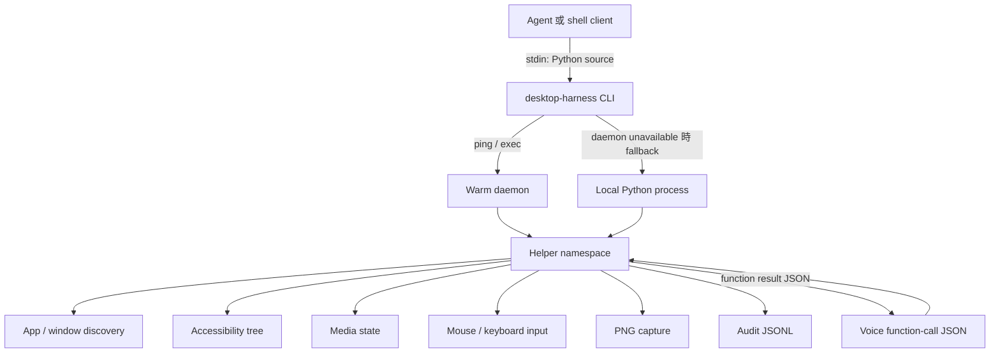
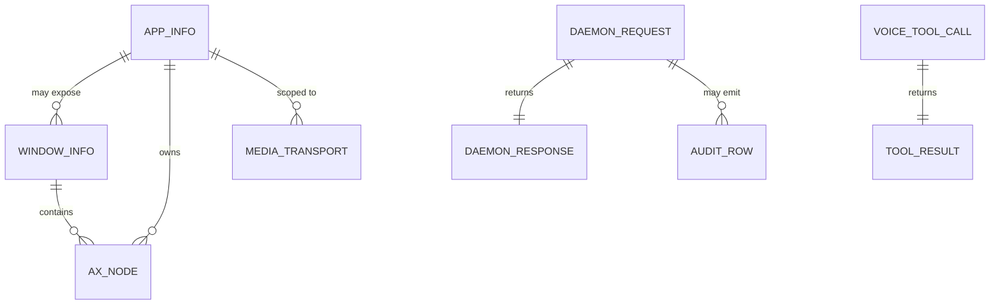

# desktop-harness 資料模型總覽

> 本目錄記錄 `desktop-harness` v0.4.2 的資料模型、持久化格式、JSON schema、狀態機與資料流。文件只描述結構與程式行為，不包含任何實際執行紀錄、憑證、客戶資料或其他敏感內容。

## 1. 核心結論

| 問題 | 答案 |
|---|---|
| 是否有關聯式資料庫？ | **沒有。** `pyproject.toml` 沒有資料庫 driver／ORM，現有模型也沒有資料表、schema migration 或 SQL。 |
| 主要資料模型 | Python `dict`、`list`、字串、數值與布林值；核心記錄以 `snake_case` key 表示。 |
| 主要持久化格式 | JSON Lines audit log、PNG 截圖、純文字 PID/token 檔，以及打包或安裝的 Markdown／Python 檔。 |
| 主要 wire format | Unix domain socket 上的 NDJSON；實驗性語音路徑使用 WebSocket JSON message。 |
| 資料生命週期 | App、window、AX node、media state 皆為即時查詢結果；audit、PNG、daemon metadata 才會落地。 |
| 是否有秘密欄位可進文件？ | 有。daemon token 必須驗證，但不記錄其內容；本文件亦不提供 token 或憑證範例。 |

## 2. 文件地圖

| 檔案 | 內容 |
|---|---|
| [`README.md`](./README.md) | 模型總覽、資料流、證據範圍與來源索引 |
| [`DATA-STRUCTURES.md`](./DATA-STRUCTURES.md) | 所有可確認的資料結構、欄位語意與集合關係 |
| [`FILE-FORMATS.md`](./FILE-FORMATS.md) | repo 與執行期檔案格式、wire protocol、環境變數與持久化策略 |
| [`JSON-SCHEMAS.md`](./JSON-SCHEMAS.md) | 核心 JSON-compatible record 與語音／daemon message 的 JSON Schema |
| [`STATE-MACHINES.md`](./STATE-MACHINES.md) | CLI routing、daemon、app activation、media、safety、AX action 與 presence 狀態轉換 |

## 3. 模型分層

| 層 | 邏輯模型 | 儲存／傳輸 | 保存期 |
|---|---|---|---|
| 執行入口 | CLI invocation、stdin Python source | shell command line、stdin | 單次呼叫 |
| 應用探索 | `AppInfo`、`WindowInfo` | Python `dict`／`list` | 即時 |
| 感知 | AX node、label list、media state | Python `dict`／`list` | 即時 |
| 操作 | mouse position、hit result、capture path | Python value／PNG path | 即時／PNG 檔案 |
| 安全稽核 | audit row | JSON Lines | append-only；目前無輪替 |
| 溫熱 daemon | request／response | Unix socket 上的 NDJSON | 單一 request／response |
| 語音工具 | function tool definition／call／result | WebSocket JSON message | 單次 tool call |
| 擴充點 | `agent-workspace/agent_helpers.py` 中的 Python helper | 動態載入的 Python 原始碼 | 使用者定義 |

## 4. 整體資料流

### 4.1 控制流與資料流邊界

- **控制流**：agent 將 Python source 交給 CLI；CLI 可在本機 process 或 warm daemon 中執行。
- **感知資料流**：AX 為主、PNG 為 fallback；資料只在 helper 回傳值或暫存檔中流動。
- **動作資料流**：AX action 優先，座標與 HID 為 fallback。
- **稽核資料流**：部分 key mutation、activation 與 screenshot 會寫 audit row；typed value 不應寫入 audit。
- **語音資料流**：模型只收到 tool schema 與 function result；語音 session scaffold 不直接操作螢幕。

## 5. 證據分級與基準

本目錄採以下證據標示：

| 標示 | 意義 |
|---|---|
| **[S]** | 在本次提供的 current source 中可直接確認 |
| **[T]** | 在本次提供的測試或 self-test 斷言中可確認 |
| **[D]** | current 文件明確描述，但對應 source 未完整提供 |
| **[I]** | 為建立完整契約所做的保守推論；不得當成穩定 wire API |

來源優先順序：

1. current Python source；
2. current self-test 與 doctor；
3. current README／architecture／skill 文件；
4. historical pre-release review、roadmap 與 postmortem。

### 5.1 本次可完整驗證的來源

- `src/desktop_harness/windows.py`
- `src/desktop_harness/safety.py`
- `src/desktop_harness/capture.py`
- `src/desktop_harness/daemon.py`
- `src/desktop_harness/voice_tools.py`
- `scripts/voice_session.py`
- `src/desktop_harness/admin.py`
- `src/desktop_harness/selftest.py`
- `src/desktop_harness/demo.py`
- `pyproject.toml`、`SKILL.md` 與各份文件

### 5.2 本次 snapshot 未提供、只能保守描述的部分

下列檔案出現在 repo file list，但本次沒有內容，因此其 exact return shape 不可宣稱為已驗證：

- `src/desktop_harness/run.py`
- `src/desktop_harness/helpers.py`
- `src/desktop_harness/ax.py`
- `src/desktop_harness/input.py`
- `src/desktop_harness/presence.py`
- `docs/fmb-security/AUDIT.md`

相關缺口已在欄位表與狀態機中明確標示，不以臆測補足。

## 6. 概念性實體關係

此圖描述邏輯關係，不代表資料庫 schema；系統沒有實體資料表。

## 7. 持久化與擴充邊界

### 7.1 內建持久化

- audit row：JSON Lines append-only。
- screenshot：PNG；預設置於系統暫存目錄，也允許 caller 指定路徑。
- daemon metadata：socket、PID 檔及 token 檔。
- installed skill：Markdown 檔。
- wheel package data：頂層 `SKILL.md` 被打包為 package data。

### 7.2 非持久化資料

- app、window、AX、media 與 mouse query result。
- daemon `stdout`／`stderr` capture buffer。
- voice WebSocket 連線中的 session state。

### 7.3 使用者定義資料

`agent-workspace/agent_helpers.py` 可加入任意 Python helper，因此可引入使用者自訂的 dict、JSON 或檔案格式。這類 schema 不屬於 desktop-harness 核心契約，無法由 repo 預先枚舉。

## 8. 安全與資料治理邊界

- 文件不記錄 daemon token、API credential、密碼或任何實際 audit row。
- audit 的 `detail` 為 event-dependent object；實際 app 名稱、路徑或 UI label 不應提交到本目錄。
- screenshot 是二進位影像，可能包含螢幕上的敏感資訊；文件只記錄容器格式，不附任何圖片。
- voice result 可能包含 UI labels；schema 只描述 envelope，不記錄 result 內容。
- `DH_ALLOW_SENSITIVE`、`DH_SAFE` 等環境變數只記錄語意與解析規則，不記錄實際值。

## 9. 維護原則

1. 新增或修改 Python return value 時，同步更新欄位表與 JSON Schema。
2. 新增 daemon `op` 時，必須同時更新 request、response、error 與狀態機。
3. 新增 audit event 時，列出欄位但不得加入實際資料列。
4. 若未來引入資料庫，必須新增獨立章節說明 migration、主鍵、索引與保留政策。
5. 本目錄描述的是 v0.4.2 契約；不相容變更需提升版本並保留 legacy 說明。
