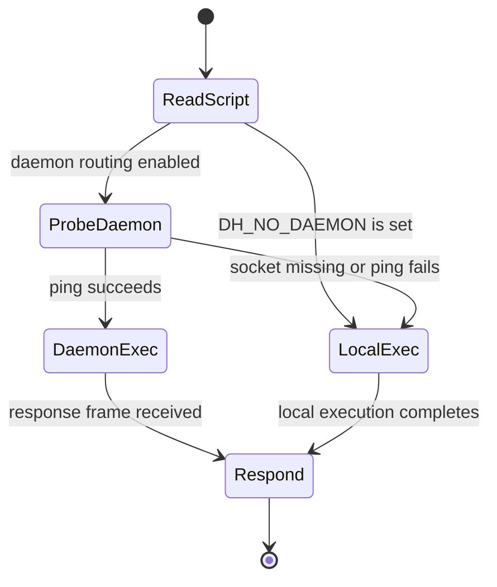
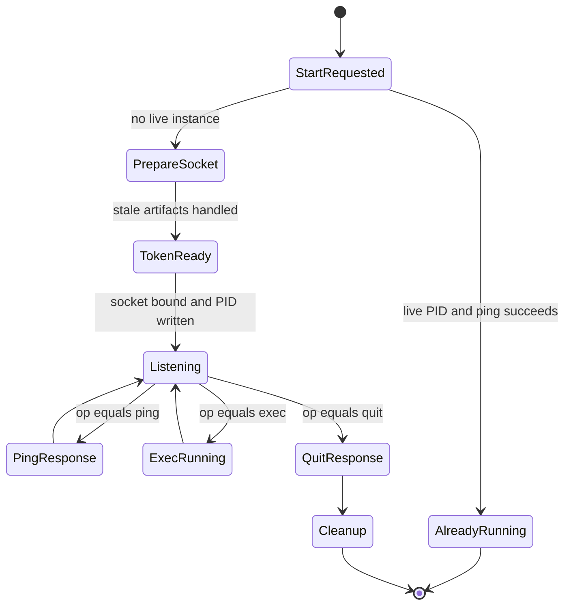
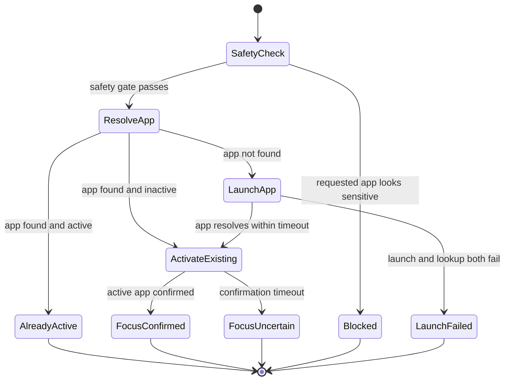
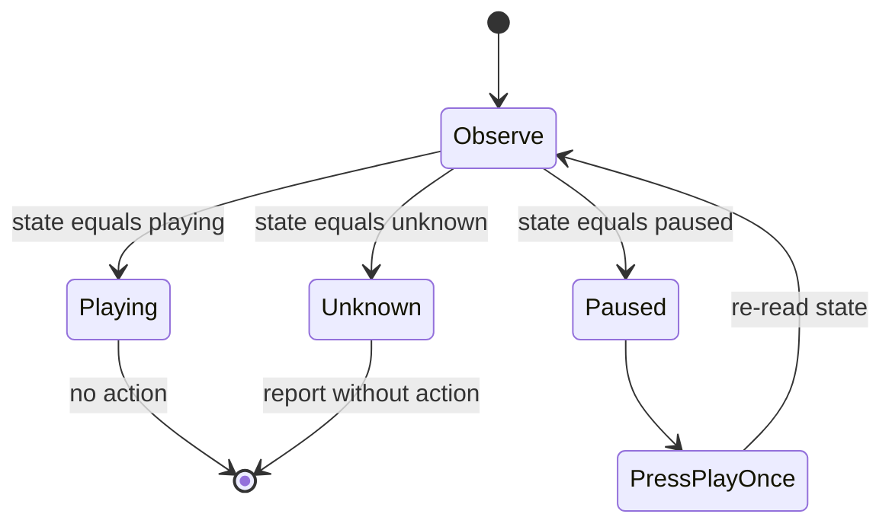
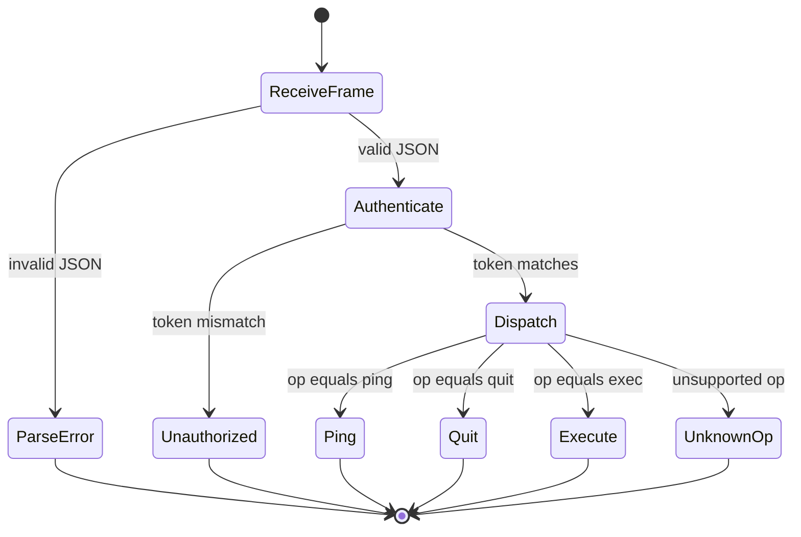
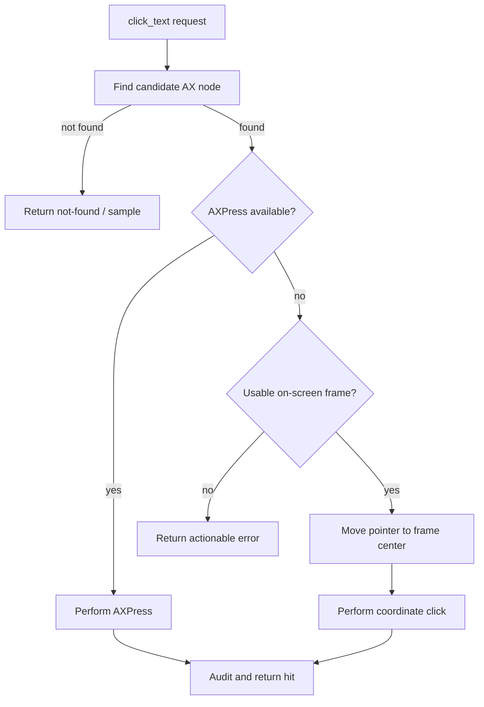
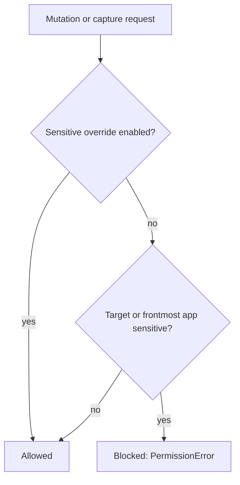
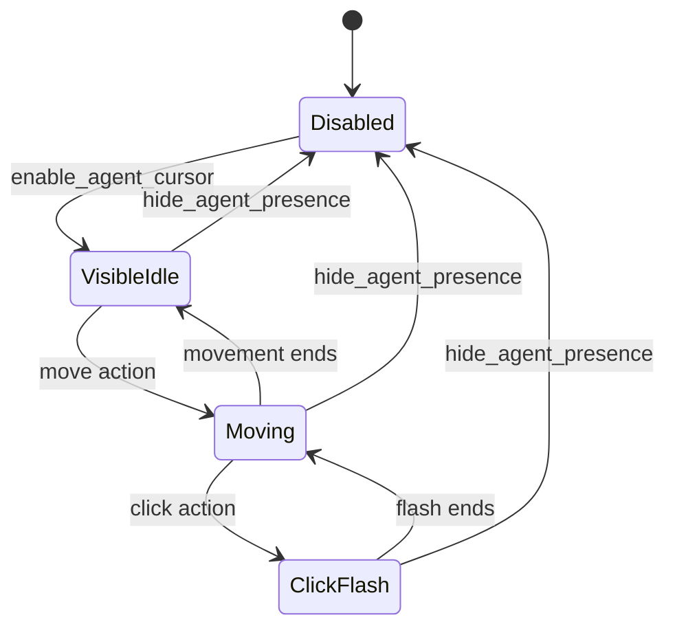
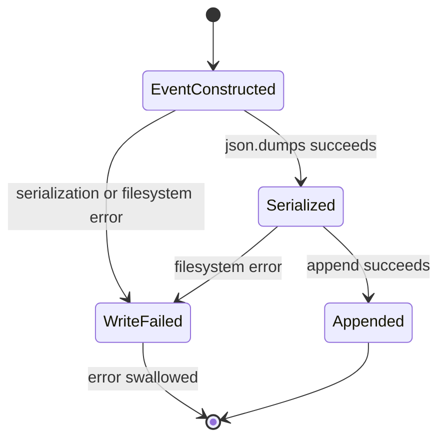

# desktop-harness 狀態機與轉換

> 本文區分 current source 可直接驗證的狀態機 **[S]**、由 current 文件描述的流程 **[D]**，以及因 source 未提供而只能作概念描述的流程 **[I]**。所有 timeout 均為程式常數，不是 SLA。

## 1. CLI 執行路由狀態機

`run.py` 未在本次 snapshot 提供；以下依 current architecture 文件與 daemon source 描述。**[D][S]**

### 1.1 轉換表

| 目前狀態 | 條件 | 下一狀態 | 行為 |
|---|---|---|---|
| `ReadScript` | `DH_NO_DAEMON` 有值 | `LocalExec` | 不探測 daemon，直接建立 local namespace。 |
| `ReadScript` | 未停用 daemon | `ProbeDaemon` | 以 daemon ping 判斷服務是否可用。 |
| `ProbeDaemon` | ping 成功 | `DaemonExec` | 將 source 送入 daemon。 |
| `ProbeDaemon` | timeout／connect error | `LocalExec` | 降級至 local process。 |
| `DaemonExec` | 收到 NDJSON response | `Respond` | 將 `stdout`／`stderr` 映射至 CLI 輸出。 |
| `LocalExec` | Python 完成 | `Respond` | 將 process stdout／stderr 映射至 CLI 輸出。 |

### 1.2 已知 timing

- Daemon health probe timeout：0.4 秒。**[S]**
- Daemon client request default timeout：60 秒。**[S]**
- `run.py` 的 exact exception-to-exit-code mapping 未驗證。

## 2. Warm daemon 生命週期

來源：`daemon.py`。**[S]**

### 2.1 啟動轉換

1. 確認 socket parent directory。
2. 讀取 PID file。
3. 若 PID 存活且 daemon ping 成功，拒絕第二個 instance。
4. 清理 stale socket。
5. 產生 opaque token 並寫入 `0600` token file。
6. 建立 Unix stream socket、bind、chmod `0600`。
7. 寫入 `0600` PID file。
8. 進入 accept loop。

### 2.2 停止轉換

收到 authenticated `quit` 後：

1. 回覆 `{"ok": true}`。
2. 關閉 listening socket。
3. 移除 socket file。
4. 移除 PID file。
5. 結束 daemon。

**目前 token file 不在 cleanup 集合中，因此 daemon 停止後仍會保留。**

### 2.3 執行期狀態

| 狀態 | 輸入 | 輸出／後果 |
|---|---|---|
| `Listening` | malformed JSON | `ok:false,error`；daemon 繼續存活。 |
| `Listening` | token mismatch | `ok:false,error`；daemon 繼續存活。 |
| `Listening` | `ping` | `ok:true,pong:true`。 |
| `Listening` | `exec` | 執行 source，回傳 `ok,stdout,stderr`。 |
| `Listening` | `quit` | 回覆後停止。 |
| `Listening` | unknown op | `ok:false,error`；daemon 繼續存活。 |

Daemon 是循序 accept loop；一個長時間 `exec` 會阻塞後續 request。Server 沒有 execution timeout。

## 3. App activation 狀態機

來源：`windows.activate()`。**[S]**

### 3.1 轉換與 timing

| 轉換 | 條件／timeout | 結果 |
|---|---|---|
| `SafetyCheck → Blocked` | requested name 或 bundle id 符合 sensitive pattern，且未允許 sensitive access | 拋出 `PermissionError`。 |
| `ResolveApp → LaunchApp` | `find_app()` 找不到 process | 先以 `open -a` 啟動，再以 NSWorkspace 備援。 |
| `LaunchApp → ActivateExisting` | 最多等待 4 秒輪詢 app list | 找到 process 後進入 activation。 |
| `ResolveApp → AlreadyActive` | app 已 active | 記錄 `activate_skip` 並立即回傳。 |
| `ActivateExisting → FocusConfirmed` | 最多 1.2 秒確認 focus | 回傳 active app。 |
| `ActivateExisting → FocusUncertain` | 1.2 秒內未確認 | audit 增加 warning，still 回傳目前可取得的 app record。 |

Cold launch 預設額外等待 0.35 秒；warm activation 預設等待 0.12 秒。Caller 可提供其他 `wait`。

### 3.2 狀態與 audit

| App state | Audit event | Detail |
|---|---|---|
| Already active | `activate_skip` | requested name 與 skip reason |
| Focus confirmed | `activate` | requested name 與 cold flag |
| Focus uncertain | `activate` | requested name、cold flag 與 warning |
| Launch failed | 無 audit row | 錯誤由 exception 表達 |

## 4. Media playback 狀態機

來源：`media_transport()`／`ensure_media_playing()` 的 current 文件與 self-test。**[T][D]**

### 4.1 轉換表

| 目前狀態 | 判斷 | 動作 | 下一狀態 |
|---|---|---|---|
| `Observe` | `state=playing`，或已有明確 playing 證據 | 不點擊 | `Playing` |
| `Observe` | `state=paused` | 找到 exact transport Play 後只按一次 | `PressPlayOnce` |
| `Observe` | `state=unknown` | 不猜測、不嘗試多個策略 | `Unknown` |
| `PressPlayOnce` | action 完成 | 重新讀取 media state | `Observe` |
| `Observe` | action 後仍 paused | 回報未成功，不自動再按 | `Paused`／terminal for this call |
| `Observe` | action 後 unknown | 回報無法確認 | `Unknown` |

### 4.2 禁止的隱含轉換

- `playing → paused`：不得以 Space 或 media key 反覆 toggle。
- `unknown → playing`：不得在沒有 transport Play 證據時猜測。
- `row_play → transport_play`：`row_play` 不等於目前 track transport control。

`ensure_media_playing()` 的每次呼叫最多執行一次 Play action；多次呼叫是不同呼叫，不能解讀成單一狀態機內的無限制 retry。

## 5. Daemon request 處理狀態機

來源：`daemon.serve()`。**[S]**

### 5.1 結果對應

| 終止狀態 | Response shape | Daemon 是否繼續 |
|---|---|---|
| `ParseError` | `ok:false,error` | 是 |
| `Unauthorized` | `ok:false,error` | 是 |
| `Ping` | `ok:true,pong:true` | 是 |
| `Quit` | `ok:true` | 否，開始 cleanup |
| `Execute` | `ok,stdout,stderr` | 是 |
| `UnknownOp` | `ok:false,error` | 是 |

## 6. AX click action 決策流程

`ax.py` 與 `helpers.py` 未完整提供；以下是 current contract 的概念流程。**[D][I]**

### 6.1 優先序

1. exact／高信心 AX match。
2. AXPress。
3. usable frame。
4. coordinate click。
5. 找不到時回報，不應猜測任意座標。

Exact matching 很重要，因為 media 文件記錄過 loose `Play` 可能誤中 `Play all` 或 row-level control。

## 7. Safety gate 狀態機

來源：`safety.py`。**[S]**

### 7.1 Gate 類型

| Gate | 判斷來源 | 行為 |
|---|---|---|
| `check_app_allowed(name, bundle_id)` | explicit target | 阻擋 sensitive name／bundle pattern。 |
| `check_frontmost_allowed()` | 目前 frontmost app | 阻擋在 sensitive app 前台時的 mutation／capture。 |
| `check_helper_allowed(name)` | helper identifier | 保留給 future high-risk helper；目前不是完整 shell sandbox。 |

### 7.2 狀態與環境變數

| 狀態 | 條件 |
|---|---|
| `Allowed` | `DH_ALLOW_SENSITIVE` 為 truthy，或 target 不符合 sensitive pattern。 |
| `Blocked` | 未允許 sensitive access，且 target／frontmost 符合 sensitive pattern。 |
| `Fail-open` | `check_frontmost_allowed()` 無法取得 frontmost app 時，current implementation 會直接返回，不拋出例外。 |

`DH_SAFE` 與 `DH_ALLOW_SENSITIVE` 是不同狀態：前者是 safe-mode policy flag，後者是 sensitive-app override。

## 8. Presence UI 概念狀態機

`presence.py` 未提供；以下僅依 observe-loop 文件描述 UI 行為。**[D][I]**

### 8.1 視覺狀態

| 狀態 | 預期呈現 |
|---|---|
| `Disabled` | 不顯示 halo／banner。 |
| `VisibleIdle` | halo 與控制提示持續可見。 |
| `Moving` | 單一 system cursor 周圍顯示 soft blue halo。 |
| `ClickFlash` | 短暫 red flash，之後回到 blue。 |

### 8.2 重要轉換 invariant

- Focus 被其他 app 搶走後，presence 仍應保持 `VisibleIdle`。
- Idle 數秒後仍應維持 `VisibleIdle`。
- Presence 不得建立第二個 fake arrow。
- `hide_agent_presence()` 應由任何 visible state 回到 `Disabled`。

這些是 UI acceptance invariant，不表示已由本次 source 驗證。

## 9. Audit 與安全事件狀態

Audit 是事件記錄，不是可回滾狀態機。其 logical lifecycle 為：

### 9.1 特性

- audit 成功不影響 helper 的主流程結果。
- audit 失敗也不會回傳給 caller。
- event 本身沒有狀態欄位；狀態只能由 event name 推論。
- 無刪除、rotation 或 archive 狀態。

## 10. 狀態機總表

| 狀態機 | 證據 | 主要轉換 |
|---|---|---|
| CLI routing | [D][S] | daemon probe、local fallback、exec、respond |
| Daemon lifecycle | [S] | start、listen、auth、exec、quit、cleanup |
| App activation | [S] | safety check、launch、activate、confirm／uncertain |
| Media playback | [T][D] | observe、no-op、press once、re-observe |
| Daemon request | [S] | parse、authenticate、dispatch、respond |
| AX click | [D][I] | find、AXPress、coordinate fallback、error |
| Safety | [S] | allowed、blocked、fail-open |
| Presence | [D][I] | disabled、idle、moving、click flash、hidden |
| Audit write | [S] | constructed、serialized、appended／failed |
